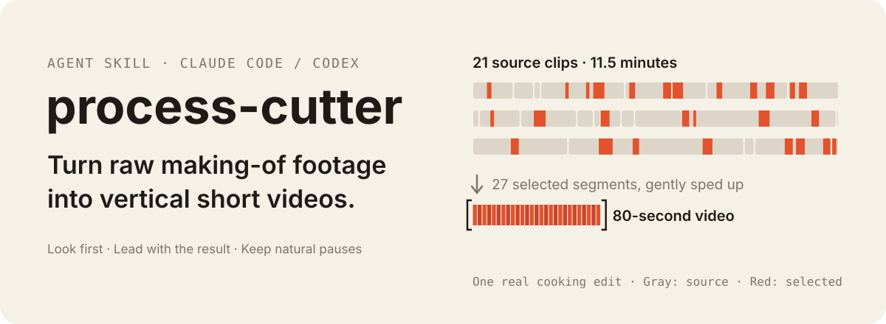
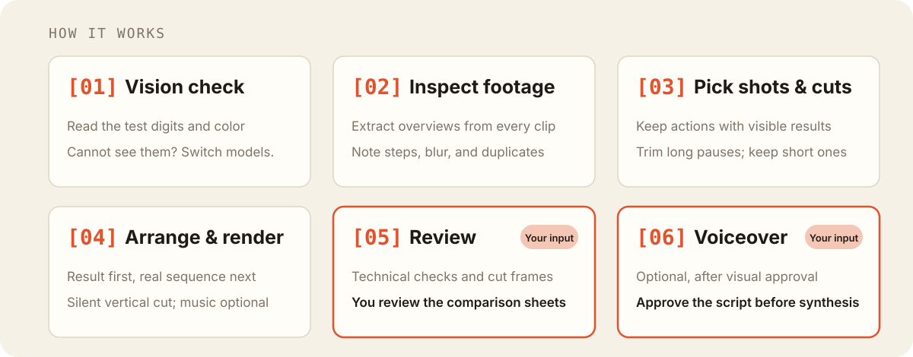

<p align="right"><a href="./README.md">简体中文</a> · <strong>English</strong></p>

<p align="center">
  
</p>

**process-cutter** is an Agent Skill for Claude Code and Codex. Give your agent a folder of phone-shot making-of footage. It inspects the frames, identifies the steps, chooses cut points, and creates a vertical video that shows the process from materials to the finished result. Start with: “Turn this folder into a video.”

## What it is for

| Subject | Examples |
|---|---|
| Cake decorating and shaped bakes | Pet cakes, buttercream piping, fondant, royal icing cookies |
| Cooking and baking | Home cooking, noodles, bread, desserts; footage with spoken explanations also works |
| Other crafts | Clay, painting, knitting, crochet, embroidery, soap, candles, resin, woodwork, leatherwork, model assembly and painting, nail art, flower arranging, latte art |
| Restoration | Sneaker cleaning, object restoration, furniture repairs |

Not intended for talking-head videos, vlogs, travel, unboxing, reviews, sports, or screen-recorded tutorials. Those depend on speech or narrative structure rather than visible production steps.

## How it works

<p align="center">
  
</p>

1. **Vision check.** The agent reads the digits and color in a random test image. If it cannot, it stops. Switch to a model or environment that can see images.
2. **Inspect footage.** It extracts overview frames from every clip and records the steps, blurry footage, and duplicates. Phone HDR footage is converted to SDR first to avoid washed-out output.
3. **Pick shots and cuts.** It examines the full action, keeps visible results, trims long pauses, and allows about one second of natural transitions. Each segment goes into a shot list with its source, in/out points, and observed action.
4. **Arrange and render.** It opens with the finished result by default, follows the real production sequence, and exports a silent vertical video. Supply music to get a version with music too.
5. **Review and deliver.** It runs technical checks, inspects frames around cuts, and creates shot comparison sheets. **Your part: scan the comparison sheets first.** If the descriptions do not match the images, the agent has misread the footage. Ask it to change the opening or any segment; it updates the shot list and renders again.
6. **Voiceover, optionally.** This starts after you approve the visuals. You review the script before the agent calls your speech synthesis service.

### Standard or fine cut

Both modes produce a complete video. You do not need to make a rough cut first.

| | Standard, the default | Fine cut |
|---|---|---|
| How to start | “Edit this folder” | Ask for a “fine cut,” “more detail,” or “closer cut-point review” |
| What it selects | The main steps, with representative complete actions | Additional details with distinct changes, such as fur texture, embossing, or outlines; each should help viewers understand more |
| How it checks | The full ordinary action at 3 frames per second | Additional 10 fps boundary checks for every segment, plus close-up frame review throughout detailed actions |
| Example | Two-cat cake: 13 shots, 56 seconds | Same footage: 19 shots, 84 seconds |

Fine cuts take longer and usually run longer. Use them when the details are part of the appeal. The modes save to separate directories and do not overwrite each other.

## Install and start

```bash
git clone https://github.com/Agengcc/process-cutter.git ~/.agents/skills/process-cutter

# Claude Code
mkdir -p ~/.claude/skills && ln -s ~/.agents/skills/process-cutter ~/.claude/skills/process-cutter
# Codex
mkdir -p ~/.codex/skills && ln -s ~/.agents/skills/process-cutter ~/.codex/skills/process-cutter
```

Then tell your agent:

> Use process-cutter to turn the footage in `~/Videos/2026-10-14` into a vertical video.

Source footage stays read-only. All outputs go into an `edit/` subfolder beside the footage.

## What you get

- **Shot comparison sheets:** three source frames for each selected segment, alongside its action description. These are presented first for review.
- **A shot list and editable project**, `project.json`. Change the shot list to revise and render again.
- **A silent vertical video**, 1080 × 1920. Supply background music for an additional version with music.
- **Optional voiceover:** the agent builds a fact card from the original speech and images, writes complete short sentences against the visuals, and asks for your approval. It then synthesizes each sentence separately, measures its duration, and renders voiceover and captions. A Volcengine/Doubao adapter is included; any command that reads a text file and writes an audio file can also be used.
- **Optional original-speech mode, off by default:** local Whisper transcribes the speech so the agent can retain complete takes without cutting off words. This uses more computing resources; the agent asks before enabling it.

## Requirements

- [FFmpeg](https://ffmpeg.org/), including ffprobe.
- Python 3.9+ and `pip install pillow numpy`.
- **A vision-capable model.** Editing is gated by the random image check; a model that cannot see the image must stop.
- For voiceover: a Volcengine account and credentials, or your own speech synthesis command.
- For original-speech mode: `mlx-whisper` and `zhconv` on an Apple Silicon Mac. Temporary installation with `uv run --with mlx-whisper --with zhconv ...` is recommended.

## Voiceover with Volcengine / Doubao

1. Enable Doubao speech synthesis in the Volcengine console. Get an API Key in the newer console, or an App ID and Access Token in the older one.
2. Set environment variables; do not put credentials in repository files:

   ```bash
   export VOLC_TTS_API_KEY=your_key
   # Older console: export VOLC_TTS_APP_ID=... VOLC_TTS_ACCESS_KEY=...
   ```

   Alternatively, use `~/.config/process-cutter/volcengine.json`: `{"api_key": "...", "voice": "voice_id"}`.
3. Choose a voice ID in the console, such as `zh_female_vv_uranus_bigtts`. Cloned voice IDs start with `S_`. Run a dry check first; it does not synthesize audio or incur synthesis charges:

   ```bash
   echo "鸡块先加生抽和生粉，用手抓匀。" > /tmp/t.txt
   python3 scripts/tts_volcengine.py --text-file /tmp/t.txt --out /tmp/t.wav --voice VOICE_ID --dry-run
   ```

   The sample sentence is Chinese: “Add light soy sauce and starch to the chicken, then mix by hand.” Remove `--dry-run` to synthesize. The adapter defaults to a bidirectional WebSocket interface and uses only the Python standard library. It infers the resource ID from the voice; use `--resource-id` to override it with the value from your console.

   If you see `requested resource not granted`, the credentials were accepted but access to that resource is missing. Enable the speech synthesis model in the console. WebSocket and HTTP access may differ for the same credentials; try `--protocol http` to use the other interface.

Then tell the agent which Volcengine voice to use. For Qwen, MiniMax, or another service, provide a command containing `{text}` and `{out}` placeholders.

Use only voices you have permission to use. Cloning someone else's voice requires authorization. Enable the platform's AI-generated content disclosure when publishing.

## Evaluate a model

Editing quality depends heavily on the model's and agent's vision capabilities. When changing models, agents, or this skill, you can score against a cut you have approved without rendering another video:

```bash
# 1. Create an answer draft from an approved cut. Add --media-dir to list all source clips.
python3 scripts/benchmark.py make footage/edit/approved --name cooking --out evaluation/cooking/answer.json --media-dir footage
# 2. Fill in acceptable openings, bonus steps, and what makes this cut good.
#    See benchmarks/README.md for the format.
# 3. Score the new shot list.
python3 scripts/benchmark.py score evaluation/cooking/answer.json footage/edit/new/选片表.csv --report score.md
```

The report covers step coverage, acceptable openings, cut-point differences, shot count, duration, and hard errors such as overlapping source ranges, unconverted HDR, or a missing vision check. Use your own footage; the repository includes only synthetic example data. Scores compare time ranges and cannot establish whether an action description is correct. You still need to review the shot comparison sheets.

## Current limitations

- Only pet cake decorating and home cooking have been tested with real footage. Other crafts and restoration use the general rules and still need validation with real material; review their comparison sheets carefully.
- Tested only on macOS. HDR, including iPhone Dolby Vision, must be converted to SDR. macOS uses the built-in avconvert tool; other systems use FFmpeg zscale.
- Results vary with the model and agent's ability to interpret images.
- Silent video is the default. Voiceover and original speech must be enabled explicitly.
- The Volcengine adapter follows the official V3 interfaces. WebSocket synthesis has been tested with a real account and a Doubao Speech 2.0 voice. HTTP has only been tested against a local mock service.
- This English README is a reader-facing translation. The skill instructions, reference guides, and many generated filenames are currently in Chinese.

## Repository layout

- `SKILL.md`: instructions for the agent, the entry point.
- `references/`: subject guides for cakes (`cake.md`) and cooking (`cooking.md`), plus fine-cut, voiceover, and review guidance. `cake-examples.md` includes four of the author's own cake screenshots as action examples.
- `scripts/`: editing, inspection, voiceover, and transcription tools. `cutter.py` renders, `qc_tools.py` generates review material, `voice_tools.py` manages voiceover, and `tts_volcengine.py` connects to Volcengine.
- `benchmarks/`: answer format and synthetic example data; score with `scripts/benchmark.py`.
- `templates/`: shot-list and delivery templates.
- `tests/`: run `python3 -m unittest discover tests`.

## Acknowledgments

- [vincentventalon/claude-code-video-editing-skill](https://github.com/vincentventalon/claude-code-video-editing-skill), MIT: ideas for original-speech transcription and take handling.
- [TinyAlmond/footage-to-vlog](https://github.com/TinyAlmond/footage-to-vlog), MIT: shot comparison sheets, vision checks, and speech take selection.
- [Fagan1024/smart-video-editor](https://github.com/Fagan1024/smart-video-editor): editing workflow ideas.
- RNNoise models are available from [richardpl/arnndn-models](https://github.com/richardpl/arnndn-models); they are not included here.

## License

MIT
