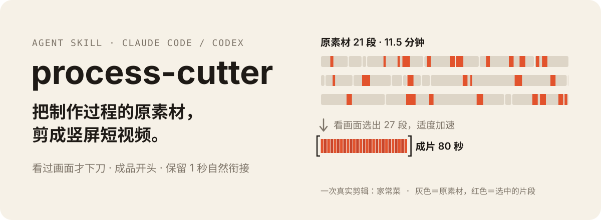
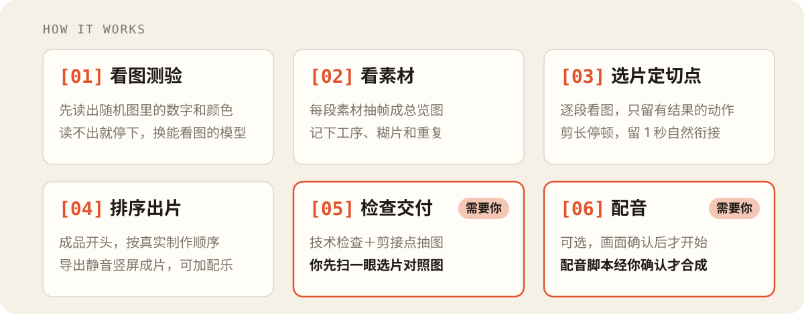

<p align="right"><a href="#english">English</a></p>

<p align="center">
  
</p>

**process-cutter（工序剪辑）** 是一个 Agent Skill，Claude Code、Codex 都能用。把一堆手机拍的“制作过程”原素材交给 Agent，它会逐段看画面、找工序、定切点，剪成一条竖屏短视频：从材料到成品，每一步都看得见变化。你只需要说一句“帮我把这个文件夹剪成视频”。

## 适合剪什么

| 题材 | 例子 |
|---|---|
| 手作蛋糕、裱花、造型烘焙 | 宠物造型蛋糕、奶油裱花、翻糖、糖霜饼干 |
| 做饭、烘焙 | 家常菜、面点、面包甜点（有人边做边讲也行） |
| 其他手作 | 黏土软陶、手绘水彩、编织钩针、刺绣、手工皂蜡烛滴胶、木工皮具、模型拼装涂装、美甲、插花、咖啡拉花 |
| 修复翻新 | 球鞋清洗、旧物翻新、家具修补 |

不适合：口播、vlog、旅行、开箱测评、运动、屏幕录制教程——它们靠讲话或叙事组织，不是靠工序。

## 它怎么工作

<p align="center">
  
</p>

1. **看图测验**：Agent 先读出一张随机图片里的数字和颜色。读不出就停下，说明当前模型或环境看不到画面，换一个能看图的模型再来。
2. **看素材**：把每段素材抽帧成总览图，记下拍了哪些工序、哪些画面糊了或重复；手机 HDR 素材会先转成普通格式，避免剪出来发灰。
3. **选片定切点**：逐段看图，只保留动作真正产生结果的部分，剪掉长停顿，保留1秒左右的自然衔接，每段都写进选片表（源文件、入出点、看到的动作）。
4. **排顺序、出片**：默认成品开头，按真实制作顺序排，导出静音竖屏成片；给了配乐就再出一版含配乐的。
5. **检查和交付**：做技术检查和剪接点抽图检查，生成选片对照图。**你要做的：先扫一眼选片对照图**，文字和画面对不上，说明模型没看清。想换开头或改哪一段，直接告诉 Agent，它改选片表后重新出片。
6. **配音（可选）**：画面确认后才开始。配音脚本先给你看，你确认后才调用配音接口。

### 标准和精剪

两种都直接出可以发布的完整成片，不是“先粗剪再精修”。

| | 标准（默认） | 精剪 |
|---|---|---|
| 怎么开启 | 直接说“剪这个文件夹” | 说“精剪”“细节多一些”“切点仔细一点” |
| 选什么 | 主要工序，每道选一段代表性的完整动作 | 再加有独立变化的细节（如刷毛、压纹、勾线），每段说明让观众多看懂什么 |
| 怎么检查 | 普通段3帧/秒看完整过程 | 每段首尾再用10帧/秒复核，细节全程看局部放大图 |
| 例子 | 两猫蛋糕：13个镜头、56秒 | 同一份素材：19个镜头、84秒 |

精剪更慢，片子通常也更长；适合细节本身就是看点的作品。两种模式另存不同目录，不会互相覆盖。

## 安装和开始

```bash
git clone https://github.com/Agengcc/process-cutter.git ~/.agents/skills/process-cutter

# Claude Code
mkdir -p ~/.claude/skills && ln -s ~/.agents/skills/process-cutter ~/.claude/skills/process-cutter
# Codex
mkdir -p ~/.codex/skills && ln -s ~/.agents/skills/process-cutter ~/.codex/skills/process-cutter
```

然后在 Agent 里说：

> 用 process-cutter 把 `~/Videos/2026-10-14` 里的素材剪成竖屏视频。

原素材只读，所有输出放在素材文件夹下的 `edit/`。

## 交付什么

- **选片对照图**：每个镜头3张原帧＋写明的有效动作，交付时最先给你看。
- **选片表**和**可编辑工程** `project.json`：想改哪段，改选片表重新出片。
- **静音竖屏成片**（1080×1920）；给了 BGM 就再出一版含配乐的。
- **配音（可选）**：先从原声和画面整理事实卡（不编造），按画面写“一句一个完整短句”的配音脚本，经你确认后逐句调用配音接口合成、量时长，再出含配音和字幕的成片。自带火山引擎（豆包语音）接入，也能接任何“读文案文件→写音频文件”的命令。
- **原声模式（可选，默认关闭）**：素材里有人讲话时，用本机 Whisper 转写，挑出说完整、没被截断的句子保留原声。较吃电脑，开启前 Agent 会先问你。

## 需要什么

- [FFmpeg](https://ffmpeg.org/)（含 ffprobe）
- Python 3.9+，以及 `pip install pillow numpy`
- **能看图的模型**。剪辑前 Agent 必须先通过一个“看图校验”（读出一张随机图片里的数字和颜色），看不了图的模型不让进入剪辑。
- 配音：火山引擎账号和密钥，或你自己的配音命令（见下文）
- 原声模式：Apple Silicon Mac 上的 `mlx-whisper`、`zhconv`（推荐用 `uv run --with mlx-whisper --with zhconv ...` 临时安装）

## 配音：接火山引擎（豆包语音）

1. 在火山引擎控制台开通“豆包语音合成”，拿到 API Key（新版控制台），或 App ID＋Access Token（旧版）。
2. 设成环境变量（不要写进任何仓库文件）：

   ```bash
   export VOLC_TTS_API_KEY=你的key
   # 旧版控制台：export VOLC_TTS_APP_ID=... VOLC_TTS_ACCESS_KEY=...
   ```

   也可以写在 `~/.config/process-cutter/volcengine.json`：`{"api_key": "...", "voice": "音色ID"}`。
3. 在控制台的音色列表里选一个音色 ID（如 `zh_female_vv_uranus_bigtts`；声音复刻音色以 `S_` 开头），先试一次不花钱的检查：

   ```bash
   echo "鸡块先加生抽和生粉，用手抓匀。" > /tmp/t.txt
   python3 scripts/tts_volcengine.py --text-file /tmp/t.txt --out /tmp/t.wav --voice 音色ID --dry-run
   ```

   去掉 `--dry-run` 就会真正合成。默认走 WebSocket 双向流式接口（只用 Python 标准库）；资源 ID 默认按音色推断，不对时用 `--resource-id` 指定（以控制台为准）。

   报 `requested resource not granted`：密钥有效，但对应资源没开通。到控制台开通语音合成大模型；同一密钥在 WebSocket 和 HTTP 接口上的授权可能不同，可加 `--protocol http` 试另一个接口。

之后告诉 Agent“配音用火山，音色 ID 是 xxx”即可。用别的服务（千问、MiniMax 等）时，给 Agent 一条含 `{text}` 和 `{out}` 的命令就行。

只用你有权使用的声音；复刻他人声音须获授权。发布时记得打开平台的“AI 生成”声明。

## 如何评测一个模型

剪辑质量主要看模型和 Agent 的看图能力。换模型、换 Agent 或改了 skill 后，可以拿一版你认可的剪辑当“标准答案”打分，不用出片、看片：

```bash
# 1. 从认可版生成答案草稿（原片还在就加 --media-dir，列出全部素材）
python3 scripts/benchmark.py make 素材/edit/认可版 --name 葱姜鸡 --out 我的评测/葱姜鸡/answer.json --media-dir 素材
# 2. 手动补：允许的开头、哪些工序是加分项、“这版好在哪”（格式见 benchmarks/README.md）
# 3. 新模型剪完后打分
python3 scripts/benchmark.py score 我的评测/葱姜鸡/answer.json 素材/edit/新版本/选片表.csv --report 评分.md
```

输出总分和逐项说明：工序覆盖、开头是否命中、切点偏差、镜头数和时长，以及同源重叠、HDR 未转、没过看图校验这类硬性错误。评测要用你自己的素材，仓库里只有一份假数据样例。分数只看时间段，不能证明“有效动作”写得对，选片对照图仍要看。

## 目前的局限

- 实际验证过的只有手作宠物蛋糕和家常菜；其他手作和翻新题材按通用规则剪，还没用真实素材验证，Agent 会在交付说明里提示你重点看选片对照图。
- 只在 macOS 上测试过；HDR（iPhone 杜比视界）素材要先转 SDR，Mac 上用系统自带的 avconvert，其他系统用 FFmpeg zscale。
- 剪辑质量很依赖模型和 Agent 的看图能力，同一份手册在不同模型上差别明显。
- 默认出静音版；配音和原声都要你明确开启。
- 火山接入按官方 V3 接口编写：WebSocket 方式已用真实账号测试（豆包语音 2.0 音色），HTTP 方式只用本地模拟服务测试过。

## 目录

- `SKILL.md`：Agent 读的操作手册（入口）
- `references/`：题材档案（`cake.md` 手作蛋糕、`cooking.md` 做饭）和精剪、配音、高效复核等专题；`cake-examples.md` 附 4 张作者自己的蛋糕截图作为“有效动作”样例
- `scripts/`：剪辑、检查、配音、转写脚本（`cutter.py` 出片，`qc_tools.py` 检查图，`voice_tools.py` 配音，`tts_volcengine.py` 火山接入）
- `benchmarks/`：评测答案格式和假数据样例（`scripts/benchmark.py` 打分）
- `templates/`：选片表和交付说明模板
- `tests/`：`python3 -m unittest discover tests`

## 致谢

- [vincentventalon/claude-code-video-editing-skill](https://github.com/vincentventalon/claude-code-video-editing-skill)（MIT）：原声转写和说话片段处理的思路
- [TinyAlmond/footage-to-vlog](https://github.com/TinyAlmond/footage-to-vlog)（MIT）：选片对照图、看图校验和原声挑句的方法
- [Fagan1024/smart-video-editor](https://github.com/Fagan1024/smart-video-editor)：剪辑流程的思路
- RNNoise 降噪模型可用 [richardpl/arnndn-models](https://github.com/richardpl/arnndn-models)（本仓库不附带）

## License

MIT

---

## English

**process-cutter** is an agent skill (Claude Code / Codex) that turns raw phone-shot "making-of" footage — cake decorating, cooking and baking, crafts such as clay, painting, knitting or model building, and restoration work — into a vertical short video. The agent inspects frames to find each step and keeps only shots where the action visibly produces a result, trims long pauses, and picks the best finished-product shot as the opening. It delivers a shot list, contact sheets, an editable `project.json`, and a silent (or BGM) vertical cut.

Workflow: vision probe (stops if the model cannot see images) → frame overviews of every clip → pick shots and cut points by looking at frames → order by the real making sequence, finished product first → render, technical and visual checks, contact sheets for you to review. Two modes: standard (default, main steps) and fine cut (more distinct details, denser boundary checks); both produce a finished video, not a rough cut.

Optional: fact-checked voiceover (script → user review → per-sentence TTS, with a built-in Volcengine/Doubao TTS adapter or any command that reads a text file and writes an audio file), and an opt-in native-speech mode using local Whisper.

Requires FFmpeg, Python 3 with Pillow and NumPy, and a vision-capable model (a vision probe gates editing). Tested on macOS with cake and cooking footage only; other crafts follow the general rules but are not yet verified. Docs are in Chinese. MIT licensed.
