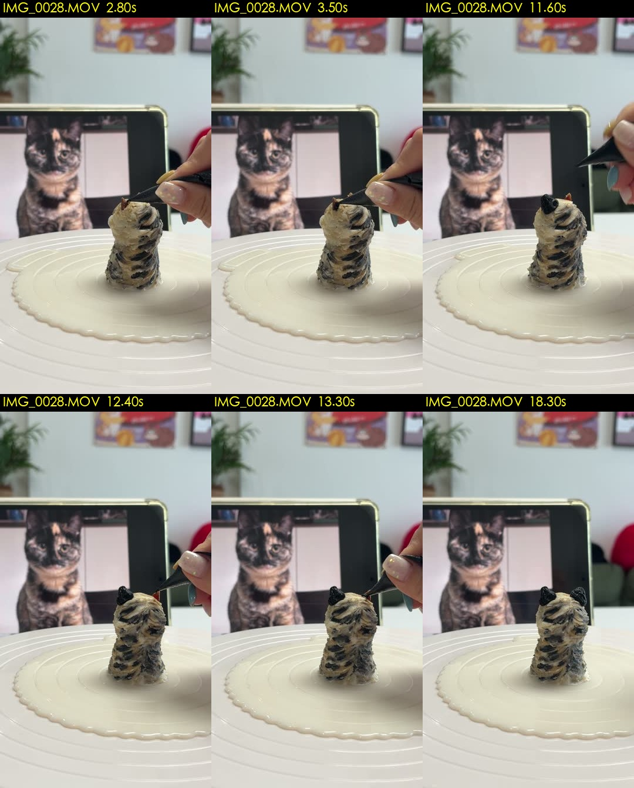
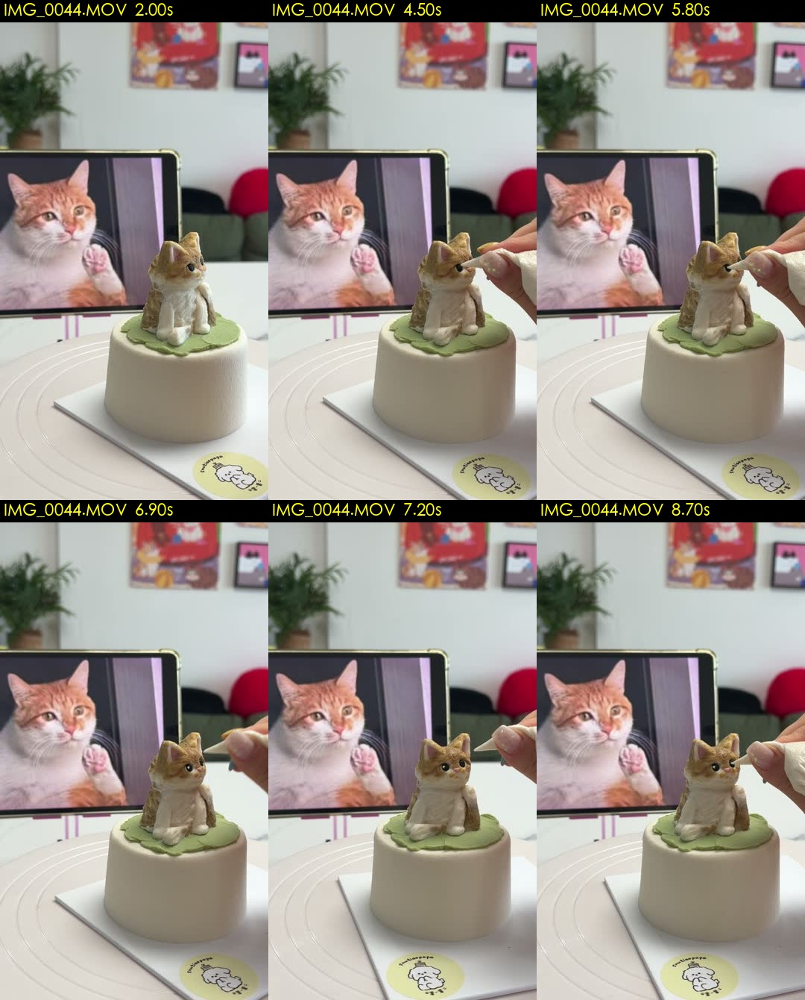
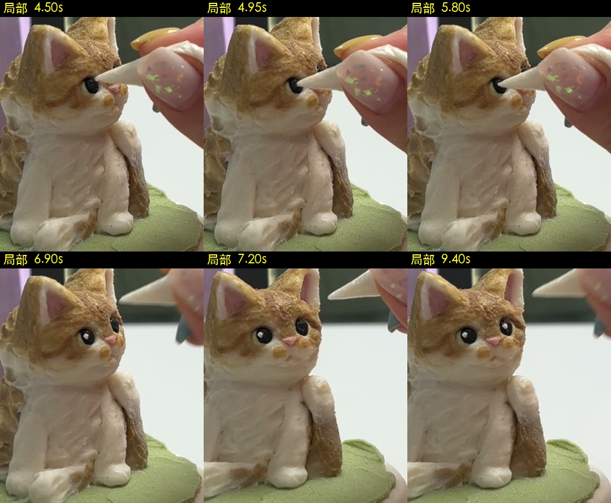
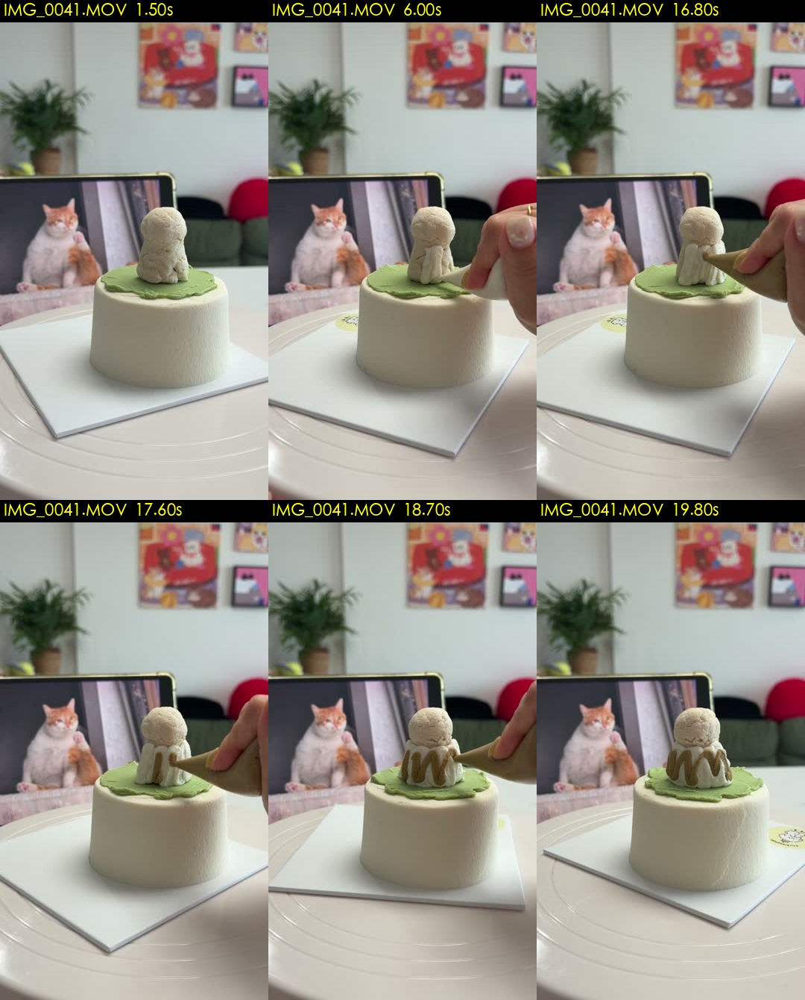

# 蛋糕动作案例（已认可）

这些是2026-09-28素材的实际修改案例，用户已认可修改版。**学习判断方法，不复制时间点。** 图片是少量定位帧，不能代替候选段全过程和边界密集复核。用户后续确认约1秒以内自然准备和换位可以保留，旧案例删短换位是当时的取舍，不是强制标准。

原片和修改前后视频保存在作者自己的蛋糕项目里，没有随本仓库发布；以本页附带图片学习案例，不编造已看过视频。

## 1. 两只耳朵：保留成对制作，换位按时长判断

- 原片：`IMG_0028.MOV`；主体：深色虎斑造型，背景真实虎斑猫用于辅助辨认。
- 旧问题：第二只耳朵未完整做完时就切出。准备阶段起手是否需要缩短，要看其成片时长，不能一概判错。
- 已认可子段：`3.27–11.67`、`13.03–18.40`，各1.5x。
- 前一子段产生并完成第一只黑耳；后一子段产生并完成另一只黑耳。当时删除了换位 `11.67–13.03`；在1.5x下约0.91秒，按当前标准也允许保留，不必为此返工。
- 图中2.80秒工具靠近不代表已有效沉积；3.50秒进入作业；11.60秒第一只耳已经成形；12.40秒属于两耳间找位；13.30秒做第二只；18.30秒两耳已成形。
- **学到的规则**：成对器官可以拆段，也可以保留短换位连着做；不能因“只选一个动作”漏掉另一只，明显长等待才需剪短。

## 2. 两眼高光：触到眼睛仍可能没成功

- 原片：`IMG_0044.MOV`；主体：橘白猫，绿色底片上的白色圆柱蛋糕。
- 旧问题：选段混入等待和未成功的试探，需确认之后真正留下高光；短暂试探或找位本身不必删除。
- 已认可子段：`5.00–6.97`、`7.67–9.50`，各1.2x。
- 约4.1–4.9秒的首次触碰没有留下本次要呈现的白高光，不能称为成功点画。先比较操作前后，确认选段包含后来真正留下白点的作业；短试探可连着成功作业保留。
- 近侧眼先成功，之后另一侧眼成功；`6.97–7.67` 是换位。开始时黑瞳孔已经存在，这段不能命名“挤黑瞳孔”。
- **学到的规则**：有效点画必须有可见结果；小五官需要局部放大。`6.97–7.67` 在1.2x下约0.58秒，按当前标准允许保留。自然的成品神态展示可单独列“展示”。

## 3. 橘斑：有手、有转动，不等于正在挤奶油

- 原片：`IMG_0041.MOV`；主体：同款橘白猫的背面，尾巴与双后肢可见。
- 旧问题：原选 `0.50–9.50`，主要是等待、工具/手移动与转盘找位，未呈现这次要看的连续挤橘斑。
- 已认可子段：`16.67–19.87`，1.5x。橘色奶油实际沉积，连续条纹逐渐出现，收笔后成形。
- 图中1.50秒是等待；6.00秒即便有手/工具也不能凭静帧直接判为橘斑作业；16.80至19.80秒能比较出橘色条纹的增长。
- 后续刷子处理是另一类工序，如果要保留需另外识别、选段，不能把“挤”和“刷”混成一个动作名。
- **学到的规则**：观察工作表面正在发生什么变化，不能靠全局运动分数或“画面里有手”判断。

## 4. 左右嘴套：短换位与少量起始省略可以接受

- 原片：`IMG_0038.MOV`；已接受样段选源 `5.87–12.33`，1.4x，位于本项目 `26-9-28/edit/新工序测试_挤嘴套_2026-10-03/`。
- 源片约5秒已开始有奶油出来，样段在第一团已有少量成形时切入。用户认可这次剪法：不必保留第一滴，主要制作过程和结果能看懂即可。
- 源片约7.3–7.7秒从一侧提笔移到另一侧，成片约0.29秒；用户明确允许这种短换位留在同一连续镜头。
- 若挤了一点后手没拿稳，短暂调整后继续，成片约1秒以内也可以保留。若长时间整理、等待、反复空挤，则剪短无效区间。
- **学到的规则**：判断主要成形与自然节奏，不以“入点错过第一滴”或“中间出现换位”单独判不合格。用户接受不代表模型已实际看片；检查记录仍按实际能力填写。

## 新素材的逐段自问

1. 正在操作哪个主体、哪个部位？辨认依据是什么？
2. 操作前什么样，动作过程中产生什么，操作后留下什么？
3. 选段是否包含成功的主要成形过程？短暂准备或首次调整能否自然衔接，不必逐笔切断？
4. 换位/调整在成片速度下有多长？约1秒以内可保留，哪些明显长停顿需要剪短？
5. 最后一笔是否做完？下一镜头有没有让部件消失或身份串线？

答不出来就补看，不能用“运动检测通过”代替答案。
